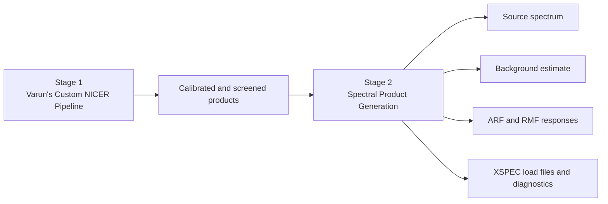
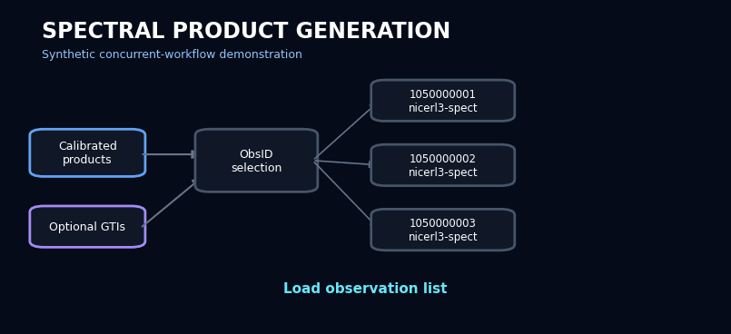

<p align="center">
  
</p>

# Spectral Product Generation

### Concurrent, GTI-aware production of X-ray spectra and response products

[](https://github.com/varunastronomy/spectral-product-generation/actions/workflows/quality-checks.yml)
[](https://www.python.org/)
[](https://github.com/varunastronomy/varun-custom-nicer-pipeline)

Spectral Product Generation is the second stage of M. Varun's public X-ray analysis workflow. It consumes calibrated and screened observation products, optionally applies observation-specific GTIs, runs the external spectral-product task concurrently across selected observations, and organizes newly generated files into dedicated `spectra/` directories.

> **Independent-software notice:** This is custom research software developed by M. Varun. It is not affiliated with, endorsed by, sponsored by, or maintained by NASA, HEASARC, the NICER mission team, or the official HEASoft/NICERDAS developers. HEASoft and NICERDAS remain the authoritative mission-processing software.
>
> **Scientific scope:** This program orchestrates `nicerl3-spect`; it does not implement calibration, screening, response generation, grouping, or background modelling itself. Results depend on the input products, optional GTIs, CALDB, and installed HEASoft/NICERDAS versions.

## **Copyright, permission, and mandatory citation**

> **COPYRIGHT © 2026 M. VARUN, CHRIST (DEEMED TO BE UNIVERSITY), BENGALURU (BANGALORE), INDIA. ALL RIGHTS RESERVED.**
>
> **NO PERMISSION IS GRANTED TO USE, COPY, MODIFY, REDISTRIBUTE, REPUBLISH, OR INCORPORATE THIS SOFTWARE INTO ANOTHER PROJECT WITHOUT PRIOR WRITTEN PERMISSION FROM THE AUTHOR. WHEN PERMISSION IS GRANTED, CLEAR ATTRIBUTION AND CITATION OF M. VARUN AND THIS REPOSITORY ARE MANDATORY.**

## Connected workflow



Previous stage: [Varun's Custom NICER Pipeline](https://github.com/varunastronomy/varun-custom-nicer-pipeline)

## Animated workflow

<p align="center">
  
</p>

The animation is a **synthetic software-workflow demonstration**. Its observation identifiers, progress states, and spectral shapes are illustrative and are not observational results or scientific validation.

## What the program provides

- Reads observation directories from a `.txt` or `.list` file.
- Supports `all`, individual ObsIDs, space-separated selections, and ObsID ranges.
- Detects working folders shared by the selected observations.
- Accepts an optional mapping of ObsIDs to GTI files.
- Runs multiple observations concurrently using available CPU cores.
- Captures standard output, standard error, and return codes for each observation.
- Continues other observations when one fails.
- Moves only files newly generated during the command into that observation's `spectra/` directory.
- Writes success and failure logs only after an explicit `y` or `yes` response.

## External scientific configuration

The invoked task uses:

```text
nicerl3-spect indir=./ \
    grouptype=optmin \
    bkgformat=file \
    bkgmodeltype=scorpeon \
    clobber=yes \
    syserrfile=NONE
```

When an ObsID has a supplied GTI, `gtifile=<path>` is appended. These are explicit workflow settings, not universal recommendations for every source or analysis objective.

## Running the program

Prerequisites:

- Python 3.10 or newer
- Configured HEASoft/NICERDAS environment
- Appropriate CALDB installation
- Calibrated observation products, such as those prepared by the previous portfolio stage

```bash
python spectral_product_generation.py
```

The program prompts for the observation-list file, ObsID selection, common products folder, optional GTI-list file, and whether logs should be written.

## GTI-list formats

Either of these forms is accepted:

```text
1050000001 /path/to/1050000001.gti
1050000002 /path/to/1050000002.gti
```

or paths from which the ObsID can be inferred:

```text
1050000001/products/burst_1.gti
1050000002/products/burst_2.gti
```

## Output and failure behaviour

Each successful observation receives a `spectra/` directory containing files created during that run. Failed observations are reported with the external return code or caught exception, while unrelated observations continue processing.

The external task can return special statuses—for example, the official documentation describes status `218` when a cleaned event has no usable good time. Interpret failures using the complete captured task output rather than the numeric code alone.

## Data-safety notes

- The command uses `clobber=yes`; preserve important earlier products before rerunning.
- Newly detected files are moved into `spectra/` only after a successful command.
- Observational data and generated mission products are excluded from Git tracking.
- The program does not determine whether an input GTI is scientifically appropriate.

## Validation boundary

Python syntax is checked automatically on GitHub. Full runtime and scientific validation require real mission products, HEASoft/NICERDAS, CALDB, source-specific GTIs, and inspection of the generated spectra and responses. Static validation is not presented as scientific validation.

Official reference: [`nicerl3-spect` complete spectral product pipeline](https://heasarc.gsfc.nasa.gov/docs/nicer/analysis_threads/nicerl3-spect/)

## Citation

Citation metadata are provided in [`CITATION.cff`](CITATION.cff). Citation does not replace the requirement to obtain prior written permission.

## Author

**M. Varun**<br>
X-ray astronomy researcher and scientific Python developer<br>
CHRIST (Deemed to be University), Bengaluru (Bangalore), India<br>
[GitHub: varunastronomy](https://github.com/varunastronomy)
